  

  

### ⚡ About Me

- 🎓 **B.Sc. (Hons.) in Computer Science & Engineering** student.
- 💼 Working at **[@tect0nic-official](https://github.com/tect0nic-official)**.
- 💻 Building modern web applications with **Next.js** and **TypeScript**.
- 🌱 Actively learning and building with **Python / Django** and **Go**.
- 💬 Ask me about **DSA / problem solving**, or reach out for open-source collaboration.

---

### 🛠️ Tech Stack

  

---

### 🚀 Featured Projects

<table align="center">
  <tr>
    <td>
      
    </td>
    <td>
      
    </td>
  </tr>
  <tr>
    <td>
      
    </td>
    <td>
      
    </td>
  </tr>
</table>

#### 🤝 Open Source Contribution

  

---

### 📊 GitHub & Coding Stats

  
  

  
  

  

---

### 🌐 Connect With Me

  
  
  
  
  
  
  
  

  

